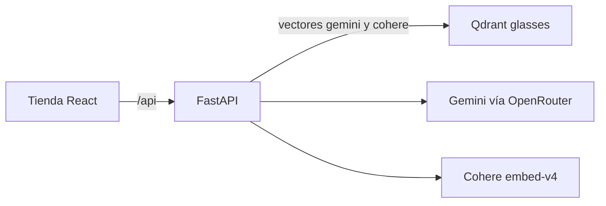
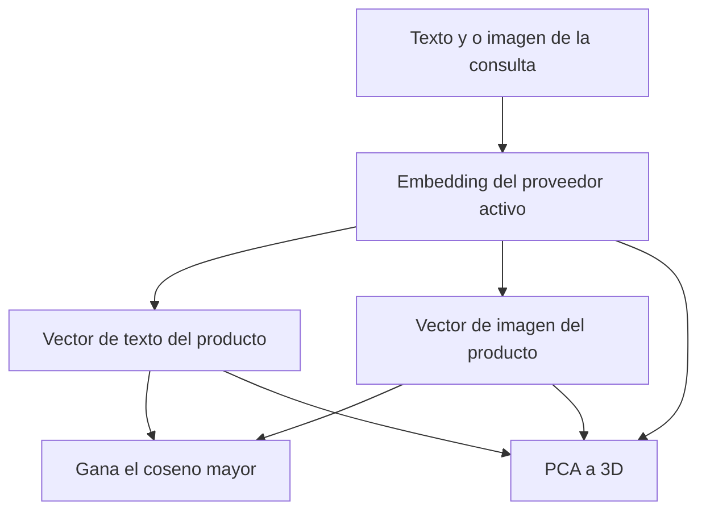

> **También en inglés:** [README.md](README.md)

# Embeddings — Lente

<p align="center">
  <strong>Busca un catálogo de gafas con texto, con una foto, o con ambos.</strong>
</p>

<p align="center">
  <a href="https://fastapi.tiangolo.com/"></a>
  <a href="https://qdrant.tech/"></a>
  <a href="https://openrouter.ai/"></a>
  <a href="https://cohere.com/"></a>
  <a href="https://react.dev/"></a>
</p>

Episodio 1 de una serie corta sobre embeddings. **Lente** es una óptica ficticia: gafas de sol y armazones, cada uno con precio, ficha corta y foto. El mostrador ordena por significado, no por palabras clave.

La misma consulta se puede embeber con Gemini o con Cohere. Los dos vectores tienen 1536 dimensiones y conviven en una sola colección de Qdrant. Los espacios no se mezclan: una consulta de Gemini solo busca el vector de Gemini.

---

## Qué puedes hacer

| | |
| - | - |
| **Ver el mostrador** | Dieciséis productos en dos grupos: gafas de sol y armazones. |
| **Buscar** | Una frase, una imagen, o las dos. El interruptor de la tienda elige el proveedor. |
| **Explicar un resultado** | Un clic dice si la consulta quedó más cerca del texto o de la foto de ese producto, y dibuja la distancia en 3D. |

Las fotos del catálogo vienen de [Unsplash](https://unsplash.com/license). Hay una imagen de prueba en `episodio-1-intro-a-embeddings/manual_tests/gafas.jpg`.

---

## Arquitectura



| Capa | Carpeta | Rol |
| ---- | ------- | --- |
| **Tienda** | [`episodio-1-intro-a-embeddings/frontend/`](episodio-1-intro-a-embeddings/frontend/) | React, TypeScript, Vite y Tailwind. El proxy de `/api` apunta al puerto 8000. |
| **API** | [`episodio-1-intro-a-embeddings/backend/`](episodio-1-intro-a-embeddings/backend/) | Catálogo en FastAPI. Un dominio, con carpetas de dominio, aplicación, infraestructura y presentación. |
| **Vectores** | [`episodio-1-intro-a-embeddings/docker-compose.yml`](episodio-1-intro-a-embeddings/docker-compose.yml) | Qdrant en el puerto 6333. |

Cada producto se guarda tres veces por proveedor:

- un vector **fusionado** (nombre, categoría, descripción y foto), que es el que rankea
- un vector de **texto**
- un vector de **imagen**

La búsqueda embebe la consulta con `search_query` y la compara con el documento fusionado. La similitud coseno es el número de la tarjeta.

---

## Por qué el clic dice "texto" o "imagen"

La barra de la tarjeta es el vector fusionado. El panel responde otra pregunta: de los dos embeddings sueltos de ese producto, ¿cuál queda más cerca de la consulta?



Dos puntos no alcanzan para tres ejes, así que la proyección también incluye los vectores fusionados del resto del catálogo. La línea une la consulta con el embedding ganador. El número del panel es el coseno original, no la distancia del dibujo.

---

## Cómo levantarlo

Hace falta [Docker](https://docs.docker.com/get-docker/), [uv](https://docs.astral.sh/uv/) y [pnpm](https://pnpm.io/installation). Python 3.13.

### 1 — Qdrant

```bash
cd episodio-1-intro-a-embeddings
docker compose up -d
```

### 2 — API

```bash
cd backend
uv sync
```

Copia el ejemplo de entorno (`copy .env.example .env` en Windows, `cp .env.example .env` en macOS y Linux). Completa `OPENROUTER_API_KEY` y `COHERE_API_KEY`. No subas ese archivo.

```bash
uv run uvicorn app.main:app --host 127.0.0.1 --port 8000
```

### 3 — Catálogo

Abre [`backend/scripts/seed_products.ipynb`](episodio-1-intro-a-embeddings/backend/scripts/seed_products.ipynb) con el entorno del backend y ejecuta todas las celdas. El notebook descarga cada foto, pide a los dos proveedores el vector fusionado, el de texto y el de imagen, y reemplaza la colección `glasses`.

### 4 — Tienda

```bash
cd episodio-1-intro-a-embeddings/frontend
pnpm install
pnpm dev
```

Abre `http://localhost:5173`. Busca y luego haz clic en un resultado.

---

## API

| Método | Ruta | Descripción |
| ------ | ---- | ----------- |
| `GET` | `/api/products` | Catálogo completo. No llama a un modelo de embeddings. |
| `POST` | `/api/search` | Multipart: `provider` (`gemini` o `cohere`), `query` opcional, `image` opcional. |
| `POST` | `/api/products/{id}/match` | El mismo formulario. Devuelve qué embedding ganó, las dos similitudes y los puntos del PCA. |

---

## Estructura

```
embeddings_rag/
├── README.md
├── README.es.md
└── episodio-1-intro-a-embeddings/
    ├── docker-compose.yml
    ├── manual_tests/gafas.jpg
    ├── backend/                 # FastAPI, cliente de Qdrant, notebook de carga
    └── frontend/                # Tienda en React
```

---

## Sobre el autor

**Leonardo Burbano** · Senior AI Engineer

[YouTube](https://www.youtube.com/@LeoBurbanoAI) · [GitHub](https://github.com/leonardoburbanov) · [LinkedIn](https://www.linkedin.com/in/leoburbano/) · [Instagram](https://www.instagram.com/leo.burbano.ai/)

Episodio 1 de una serie sobre embeddings. La tienda, la marca y los códigos de modelo son ficticios.
