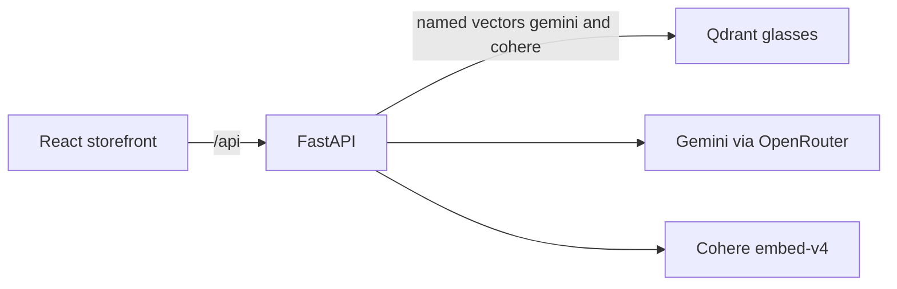
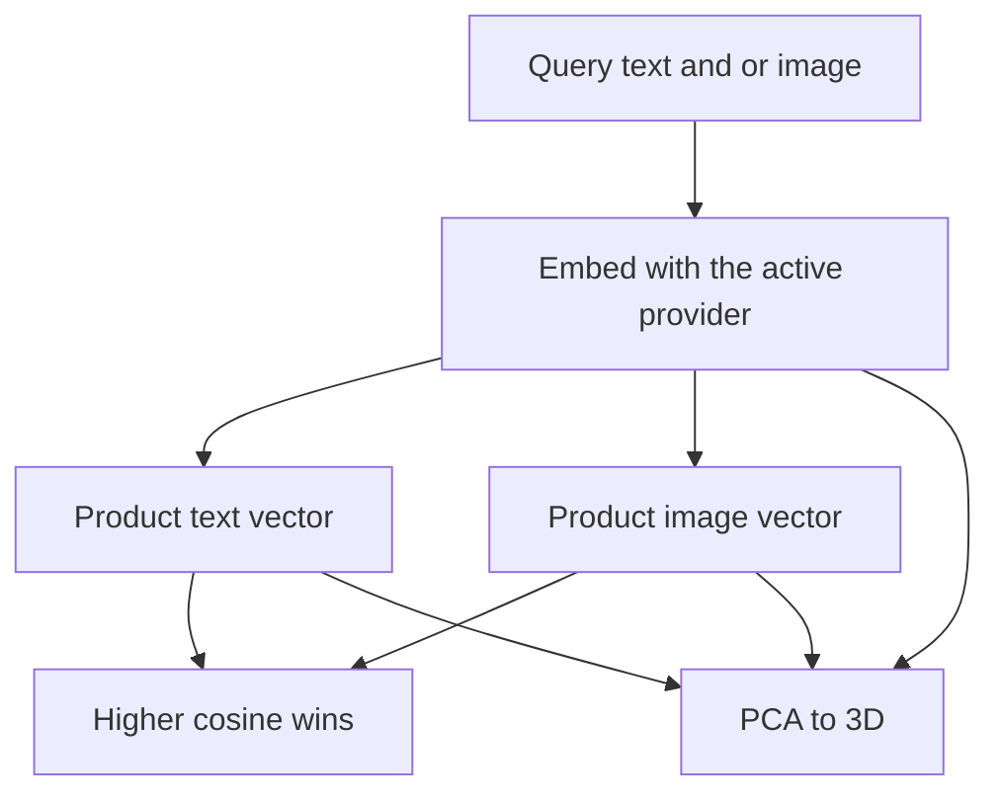

> **Also available in Spanish:** [README.es.md](README.es.md)

# Embeddings — Lente

<p align="center">
  <strong>Search a glasses catalog with text, a photo, or both.</strong>
</p>

<p align="center">
  <a href="https://fastapi.tiangolo.com/"></a>
  <a href="https://qdrant.tech/"></a>
  <a href="https://openrouter.ai/"></a>
  <a href="https://cohere.com/"></a>
  <a href="https://react.dev/"></a>
</p>

Episode 1 of a small series on embeddings. **Lente** is a fictional optical shop: sunglasses and frames, each with a price, a short spec, and a photo. The counter ranks products by meaning, not by keywords.

The same query can be embedded with Gemini or with Cohere. Both vectors are 1536 dimensions and live side by side in one Qdrant collection. The spaces are not interchangeable, so a Gemini query only searches the Gemini vector.

---

## What you can do

| | |
| - | - |
| **Browse** | Sixteen products in two groups: gafas de sol and armazones. |
| **Search** | A phrase, an image, or both. The storefront toggle picks the provider. |
| **Explain a hit** | Click a result. The panel says whether the query landed closer to that product's text or to its photo, and draws the distance in 3D. |

Catalog photos come from [Unsplash](https://unsplash.com/license). A sample query image sits in `episodio-1-intro-a-embeddings/manual_tests/gafas.jpg`.

---

## Architecture



| Layer | Folder | Role |
| ----- | ------ | ---- |
| **Storefront** | [`episodio-1-intro-a-embeddings/frontend/`](episodio-1-intro-a-embeddings/frontend/) | React, TypeScript, Vite, Tailwind. Proxies `/api` to port 8000. |
| **API** | [`episodio-1-intro-a-embeddings/backend/`](episodio-1-intro-a-embeddings/backend/) | FastAPI catalog. One domain, with domain, application, infrastructure, and presentation. |
| **Vectors** | [`episodio-1-intro-a-embeddings/docker-compose.yml`](episodio-1-intro-a-embeddings/docker-compose.yml) | Qdrant on port 6333. |

Each product is stored three times per provider:

- a **fused** vector (name, category, description, and photo) used for ranking
- a **text** vector
- an **image** vector

Search embeds the query with `search_query` and compares it to the fused `search_document` vector. Cosine similarity is the score on the card.

---

## Why a click can say "text" or "image"

The card score is the fused vector. The panel answers a different question: of this product's two separate embeddings, which one is closer to the query?



Two points cannot span three axes, so the projection also includes the fused vectors of the rest of the catalog. The line is drawn between the query and the winning embedding. The number on the panel is the original cosine, not the distance in the drawing.

---

## Run it

You need [Docker](https://docs.docker.com/get-docker/), [uv](https://docs.astral.sh/uv/), and [pnpm](https://pnpm.io/installation). Python 3.13.

### 1 — Qdrant

```bash
cd episodio-1-intro-a-embeddings
docker compose up -d
```

### 2 — API

```bash
cd backend
uv sync
```

Copy the example env file (`copy .env.example .env` on Windows, `cp .env.example .env` on macOS and Linux). Fill `OPENROUTER_API_KEY` and `COHERE_API_KEY`. Do not commit that file.

```bash
uv run uvicorn app.main:app --host 127.0.0.1 --port 8000
```

### 3 — Catalog

Open [`backend/scripts/seed_products.ipynb`](episodio-1-intro-a-embeddings/backend/scripts/seed_products.ipynb) with the backend environment and run every cell. The notebook downloads each photo, asks both providers for the fused, text, and image vectors, and replaces the `glasses` collection.

### 4 — Storefront

```bash
cd episodio-1-intro-a-embeddings/frontend
pnpm install
pnpm dev
```

Open `http://localhost:5173`. Search, then click a result.

---

## API

| Method | Path | Description |
| ------ | ---- | ----------- |
| `GET` | `/api/products` | Full catalog. Does not call an embedding model. |
| `POST` | `/api/search` | Multipart: `provider` (`gemini` or `cohere`), optional `query`, optional `image`. |
| `POST` | `/api/products/{id}/match` | Same form. Returns which embedding won, both scores, and the PCA points. |

---

## Layout

```
embeddings_rag/
├── README.md
├── README.es.md
└── episodio-1-intro-a-embeddings/
    ├── docker-compose.yml
    ├── manual_tests/gafas.jpg
    ├── backend/                 # FastAPI, Qdrant client, seed notebook
    └── frontend/                # React storefront
```

---

## About the author

**Leonardo Burbano** · Senior AI Engineer

[YouTube](https://www.youtube.com/@LeoBurbanoAI) · [GitHub](https://github.com/leonardoburbanov) · [LinkedIn](https://www.linkedin.com/in/leoburbano/) · [Instagram](https://www.instagram.com/leo.burbano.ai/)

Episode 1 of an embeddings series. The shop, the brand, and the model codes are fictional.
